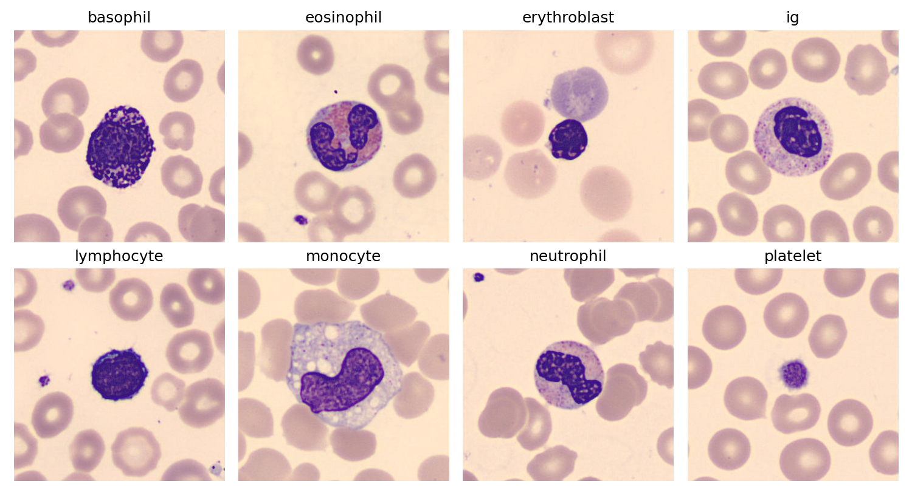
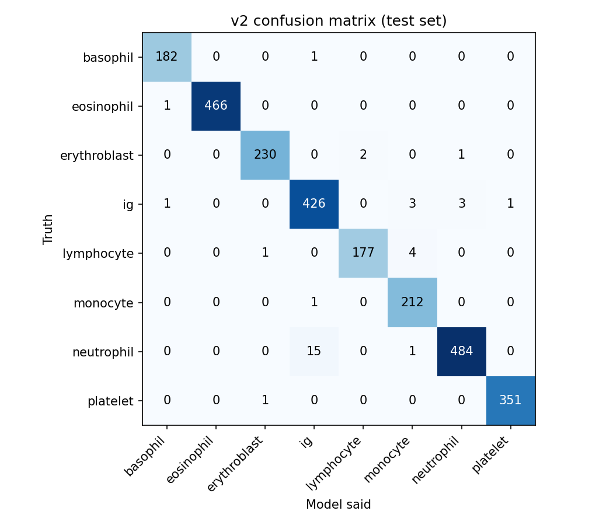
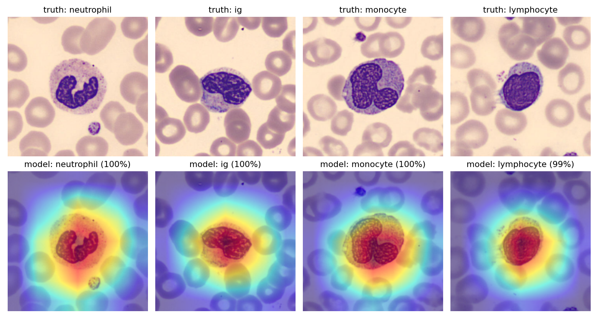
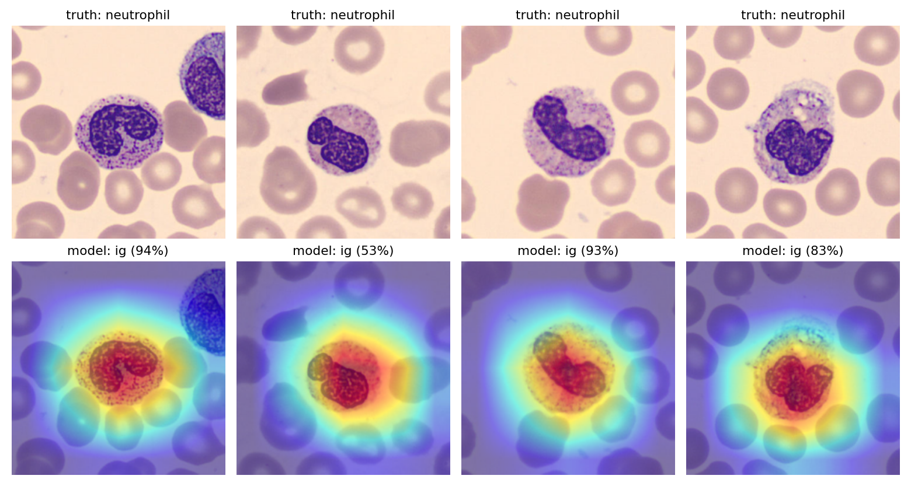

# WBC Differentiator

A beginner-friendly deep learning project that classifies microscope images of peripheral blood cells into 8 types. Built as a learning project by a Medical Laboratory Science student.

> **For education only.** This is not a diagnostic tool and has not been validated for clinical use.

## What it does

Given a single cell image, the model predicts one of 8 classes: neutrophil, eosinophil, basophil, lymphocyte, monocyte, immature granulocyte (ig), erythroblast, or platelet.

*One random test image from each class, from the Acevedo et al. dataset (see "License and attribution" below). Images were arranged in a labeled grid for this figure.*

## Dataset

- **Source:** Acevedo et al., "A dataset of microscopic peripheral blood cell images for development of automatic recognition systems," *Data in Brief*, 2020 (hosted on Mendeley Data).
- **Size:** 17,092 JPG images, about 360 x 363 pixels, 8 classes, annotated by expert clinical pathologists.
- **Collection:** normal cells from individuals without infection, hematologic or oncologic disease, imaged on a CellaVision DM96 at the Hospital Clinic of Barcelona.
- **Class counts:** neutrophil 3,329 / eosinophil 3,117 / ig 2,895 / platelet 2,348 / erythroblast 1,551 / monocyte 1,420 / basophil 1,218 / lymphocyte 1,214.
- The images are **not** stored in this repo, apart from the sample figure. Download the dataset from the Mendeley Data page.

## Method

- **Split:** 70 / 15 / 15 train / validation / test, stratified by class so each split keeps the same cell-type mix (11,964 / 2,564 / 2,564 images, `random_state=42`). The exact split is saved in `train.csv`, `val.csv` and `test.csv`.
- **Model:** ResNet18 pretrained on ImageNet (transfer learning), with the final layer replaced by an 8-class layer. Images are resized to 224 x 224.
- **Training:** Google Colab (free T4 GPU), Adam optimizer, learning rate 1e-4, batch size 64.
- **v1:** 3 epochs, no augmentation.
- **v2:** 6 epochs, random flips and small brightness, contrast and saturation changes. The best epoch was chosen using the validation set only.
- The test set was used **once per model**, after the model was chosen.

## Results

| Model | Validation accuracy | Test accuracy |
|---|---|---|
| v1 | 0.981 | 0.984 |
| v2 | 0.987 | 0.986 |

The overall difference between v1 and v2 is small, about 5 images out of 2,564, and is within the range of normal variation.

F1 score per class on the test set:

| Class | v1 | v2 |
|---|---|---|
| basophil | 0.981 | 0.992 |
| eosinophil | 1.000 | 0.999 |
| erythroblast | 0.983 | 0.989 |
| ig | 0.966 | 0.971 |
| lymphocyte | 0.981 | 0.981 |
| monocyte | 0.986 | 0.979 |
| neutrophil | 0.977 | 0.980 |
| platelet | 0.997 | 0.997 |

## What the errors look like

About half of the mistakes (18 of 36 for v2 on the test set) involve one pair: **neutrophils and immature granulocytes (ig)**. The dataset authors group promyelocytes, myelocytes and metamyelocytes into the ig class and note that the differences among those stages are subjective even for clinical pathologists, so a confusion with mature neutrophils at the border is not surprising. Reviewing the mistakes by eye, roughly half looked like reasonable calls a human could also make.

*Confusion matrix for v2 on the test set. Rows are the true cell type, columns are what the model said, and the diagonal is correct answers.*

v2 shifted that decision line: ig recall rose from 0.959 to 0.982, while ig precision fell from 0.974 to 0.962 and neutrophil recall fell from 0.976 to 0.968. In other words, v2 flags more borderline cells as immature.

## Looking inside the model

**Heat maps (Grad-CAM).** To see where v2 looks when it decides, I used Grad-CAM. In the examples I checked, the heat sits on the nucleus and cell body rather than on the surrounding red blood cells, and it scales with the cell: widest on the large monocyte, tightest on the small lymphocyte. Grad-CAM is coarse, so it shows where the model looked, not exactly why it decided.

*Four correctly classified test cells (top row) with the model's heat map below each.*

On neutrophils that v2 called ig, the heat also lands on the cell itself, but the model is less sure of itself: confidence was 53% to 94% in the four examples shown, against 99% to 100% on the easy cases above.

*Test-set neutrophils that v2 labeled as ig, with the heat map for the model's answer.*

**Confidence as a flag for review.** Cells where the model's top confidence falls below a threshold are the ones most likely to be wrong. On the test set (2,564 cells, 36 mistakes for v2):

| Flag cells below | Cells flagged | Mistakes caught |
|---|---|---|
| 0.90 | 3.2% | 22 of 36 |
| 0.95 | 4.6% | 28 of 36 |
| 0.99 | 9.4% | 32 of 36 |

Four mistakes were made with 99% or higher confidence, so confidence alone cannot catch every error. This was an exploratory look at the test set. A threshold for real use would need to be chosen on the validation set and then confirmed.

## Limitations

- All images come from one source (one lab, one scanner, one staining routine). Performance on slides from elsewhere is unknown and is likely lower.
- The split was random by image. If near-identical images from the same slide landed in both train and test, scores may be slightly optimistic.
- The model must pick one of 8 labels. It has no "none of the above" option and will give a confident answer even for a non-cell image.
- Heat maps are coarse and show where the model looked, not a full explanation of its reasoning. The confidence results come from the test set and are exploratory.
- Only 8 types of normal cells are covered. Abnormal cells, artifacts and other classes are not, and the training images come from people without infection or hematologic disease.

## Repo contents

- `01_setup_check.ipynb`: environment check
- `01_explore_data.ipynb`: class counts, sample images, image sizes
- `02_split_data.ipynb`: stratified split and image loader
- `03_train_resnet18.ipynb`: first training run (v1)
- `04_review_and_test.ipynb`: error review, v2 training, test results
- `05_heatmaps.ipynb`: Grad-CAM heat maps and the confidence check
- `train.csv`, `val.csv`, `test.csv`: the exact data split
- `images/`: figures used in this README
- `requirements.txt`: Python packages for the local notebooks

Model weights are kept outside the repo in Google Drive.

## How to reproduce

1. Download the dataset from the Mendeley Data page and unzip it into a `Data` folder.
2. Create a virtual environment and install `requirements.txt`.
3. Run notebooks 01 and 02 locally to explore and split the data.
4. Run notebooks 03, 04 and 05 in Google Colab with a GPU (the paths in the CSVs are rewritten there).

## License and attribution

The cell images come from a dataset licensed under [CC BY 4.0](https://creativecommons.org/licenses/by/4.0/). This project is not endorsed by the dataset authors.

- **Dataset:** Acevedo A, Merino A, Alférez S, Molina Á, Boldú L, Rodellar J. "A dataset for microscopic peripheral blood cell images for development of automatic recognition systems." Mendeley Data, V1, 2020. DOI: [10.17632/snkd93bnjr.1](https://data.mendeley.com/datasets/snkd93bnjr/1)
- **Data article:** Acevedo A, Merino A, Alférez S, Molina Á, Boldú L, Rodellar J. "A dataset of microscopic peripheral blood cell images for development of automatic recognition systems." *Data in Brief*. 2020;30:105474. doi: [10.1016/j.dib.2020.105474](https://doi.org/10.1016/j.dib.2020.105474)
- **Related paper:** Acevedo A, Alférez S, Merino A, Puigví L, Rodellar J. "Recognition of peripheral blood cell images using convolutional neural networks." *Computer Methods and Programs in Biomedicine*. 2019;180:105020. doi: [10.1016/j.cmpb.2019.105020](https://doi.org/10.1016/j.cmpb.2019.105020)

**Changes made:** the images were resized to 224 x 224 pixels for model training, and the figure `images/sample_cells.png` shows a selection of images arranged in a labeled grid. The dataset authors state the data is intended for research and educational purposes only.
