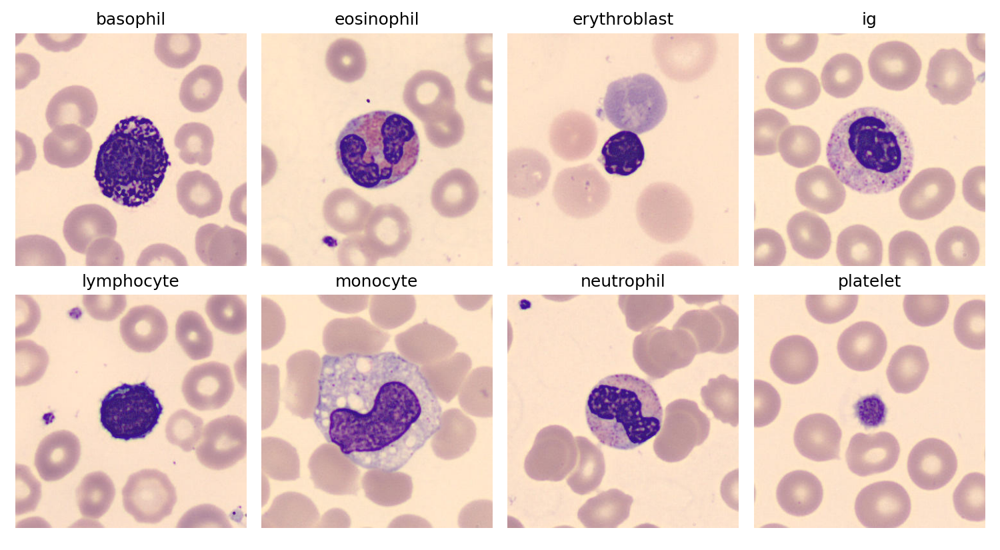
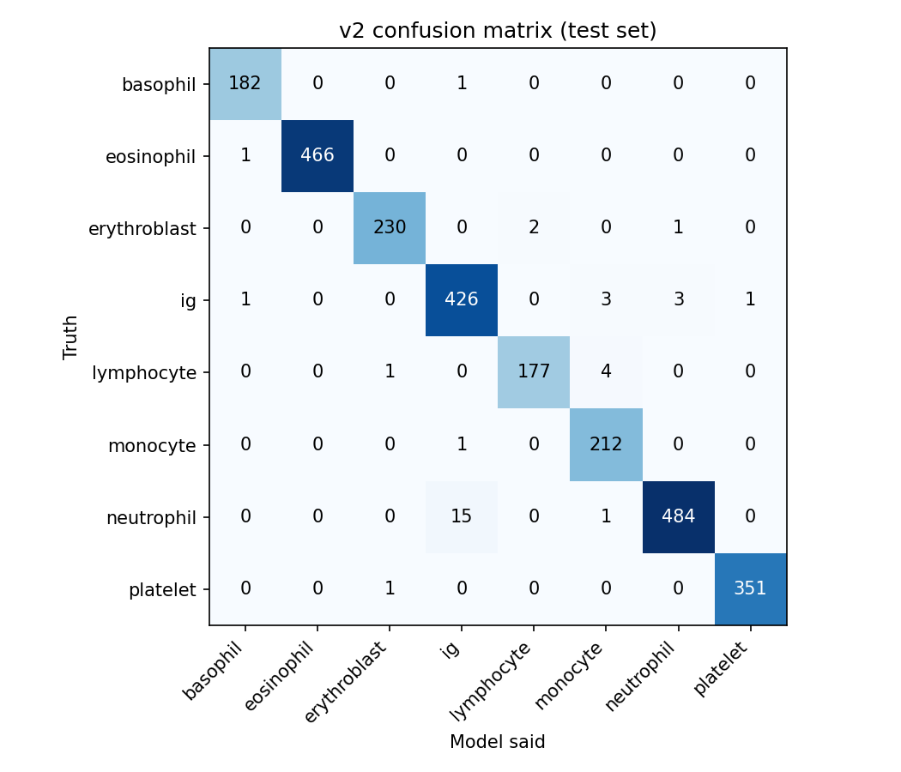
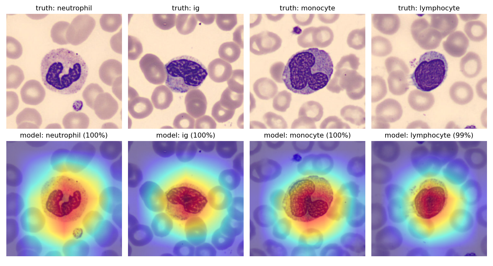
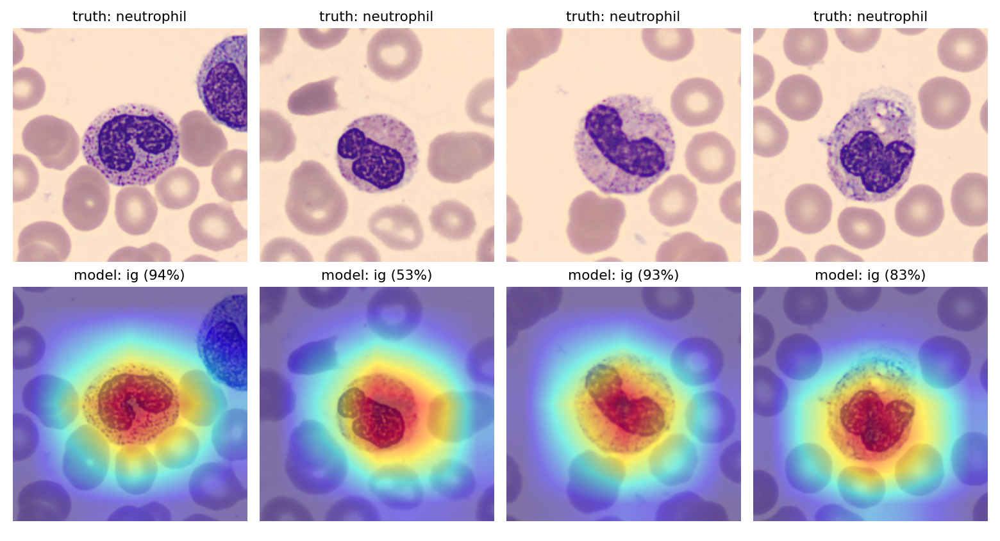

# WBC Differentiator

A beginner-friendly deep learning project that classifies microscope images of peripheral blood cells into 8 types. Built as a learning project by a Medical Laboratory Science student.

> **For education only.** This is not a diagnostic tool and has not been validated for clinical use.

## What it does

Given a single cell image, the model predicts one of 8 classes: neutrophil, eosinophil, basophil, lymphocyte, monocyte, immature granulocyte (ig), erythroblast, or platelet.

*One random test image from each class, from the Acevedo et al. dataset (see "License and attribution" below). Images were arranged in a labeled grid for this figure.*

## Dataset

- **Source:** Acevedo et al., "A dataset of microscopic peripheral blood cell images for development of automatic recognition systems," *Data in Brief*, 2020 (hosted on Mendeley Data).
- **Size:** 17,092 JPG images, about 360 x 363 pixels, 8 classes, annotated by expert clinical pathologists.
- **Collection:** normal cells from individuals without infection, hematologic or oncologic disease, imaged on a CellaVision DM96 at the Hospital Clinic of Barcelona.
- **Staining and timing:** the smears were stained with May-Grünwald-Giemsa on an automated stainer, and the images were collected between 2015 and 2019.
- **Class counts:** neutrophil 3,329 / eosinophil 3,117 / ig 2,895 / platelet 2,348 / erythroblast 1,551 / monocyte 1,420 / basophil 1,218 / lymphocyte 1,214.
- **Neutrophil class:** the dataset paper lists only "neutrophils". The image file names use two prefixes, `BNE_` and `SNE_`, and on a visual check by the author (a Medical Laboratory Science student) they look like band and segmented neutrophils, so the class appears to contain both.
- The images are **not** stored in this repo, apart from the sample figure. Download the dataset from the Mendeley Data page.

## Method

- **Split:** 70 / 15 / 15 train / validation / test, stratified by class so each split keeps the same cell-type mix (11,964 / 2,564 / 2,564 images, `random_state=42`). The exact split is saved in `train.csv`, `val.csv` and `test.csv`.
- **Model:** ResNet18 pretrained on ImageNet (transfer learning), with the final layer replaced by an 8-class layer. Images are resized to 224 x 224.
- **Training:** Google Colab (free T4 GPU), Adam optimizer, learning rate 1e-4, batch size 64.
- **v1:** 3 epochs, no augmentation.
- **v2:** 6 epochs, random flips and small brightness, contrast and saturation changes. The best epoch was chosen using the validation set only.
- The test set was used **once per model**, after the model was chosen.

## Results

| Model | Validation accuracy | Test accuracy |
|---|---|---|
| v1 | 0.981 | 0.984 |
| v2 | 0.987 | 0.986 |

The overall difference between v1 and v2 is small, about 5 images out of 2,564, and is within the range of normal variation.

These scores are for images from the same lab as the training data. On a second lab's images, v2 scored 27.2% (see [External test](#external-test-a-second-labs-images-mll23) below).

F1 score per class on the test set:

| Class | v1 | v2 |
|---|---|---|
| basophil | 0.981 | 0.992 |
| eosinophil | 1.000 | 0.999 |
| erythroblast | 0.983 | 0.989 |
| ig | 0.966 | 0.971 |
| lymphocyte | 0.981 | 0.981 |
| monocyte | 0.986 | 0.979 |
| neutrophil | 0.977 | 0.980 |
| platelet | 0.997 | 0.997 |

## What the errors look like

About half of the mistakes (18 of 36 for v2 on the test set) involve one pair: **neutrophils and immature granulocytes (ig)**. The dataset authors group promyelocytes, myelocytes and metamyelocytes into the ig class and note that the differences among those stages are subjective even for clinical pathologists, so a confusion with mature neutrophils at the border is not surprising. Reviewing the mistakes by eye, roughly half looked like reasonable calls a human could also make.

*Confusion matrix for v2 on the test set. Rows are the true cell type, columns are what the model said, and the diagonal is correct answers.*

v2 shifted that decision line: ig recall rose from 0.959 to 0.982, while ig precision fell from 0.974 to 0.962 and neutrophil recall fell from 0.976 to 0.968. In other words, v2 flags more borderline cells as immature.

## Looking inside the model

**Heat maps (Grad-CAM).** To see where v2 looks when it decides, I used Grad-CAM. In the examples I checked, the heat sits on the nucleus and cell body rather than on the surrounding red blood cells, and it scales with the cell: widest on the large monocyte, tightest on the small lymphocyte. Grad-CAM is coarse, so it shows where the model looked, not exactly why it decided.

*Four correctly classified test cells (top row) with the model's heat map below each.*

On neutrophils that v2 called ig, the heat also lands on the cell itself, but the model is less sure of itself: confidence was 53% to 94% in the four examples shown, against 99% to 100% on the easy cases above.

*Test-set neutrophils that v2 labeled as ig, with the heat map for the model's answer.*

**Confidence as a flag for review.** Cells where the model's top confidence falls below a threshold are the ones most likely to be wrong. On the test set (2,564 cells, 36 mistakes for v2):

| Flag cells below | Cells flagged | Mistakes caught |
|---|---|---|
| 0.90 | 3.2% | 22 of 36 |
| 0.95 | 4.6% | 28 of 36 |
| 0.99 | 9.4% | 32 of 36 |

Four mistakes were made with 99% or higher confidence, so confidence alone cannot catch every error. This was an exploratory look at the test set. A threshold for real use would need to be chosen on the validation set and then confirmed. On a second lab's images this check did not hold up (see the external test below).

## External test: a second lab's images (MLL23)

I ran the v2 model, with no retraining, on images from a different lab to see whether the home result carries over. It does not.

**Headline result:** 27.2% accuracy (6,062 of 22,322 images) on the 7 classes that match between the two datasets, against 98.6% on the home test split. Mean per-class recall was about 44%.

**Data:** MLL23, from the Munich Leukemia Laboratory (288 x 288 px images covering 25 x 25 µm, 18 classes). Compared with the Barcelona data, the MLL23 smears came from adults with a wide range of blood diseases (collected 2021 to 2024), were stained with the Pappenheim method and scanned on a different system (Metafer, MetaSystems, against the CellaVision DM96), and each image was labeled by one of five examiners. Classes were mapped to this project's classes:

- neutrophil: MLL23 segmented neutrophils
- eosinophil, basophil, monocyte: same names
- lymphocyte: MLL23 typical lymphocytes only
- erythroblast: MLL23 "normoblast"
- ig: MLL23 metamyelocyte, myelocyte and promyelocyte (1,975 images)

Platelets have no counterpart in MLL23. MLL23 band neutrophils (687 images) were left out of the headline number. Because the Barcelona neutrophil class appears to include band forms (see Dataset), counting them as neutrophils would be a reasonable alternative mapping. The model called none of them neutrophil, so accuracy would be about 26.3% (6,062 of 23,009 images); the headline stays 27.2%. The class mapping is my own and has not been reviewed by a hematologist; in particular, I have not confirmed that MLL23 "normoblast" and the Barcelona "erythroblast" class are defined the same way.

| MLL23 class | Called correctly |
|---|---|
| normoblast (erythroblast) | 95% |
| monocyte | 93% |
| basophil | 57% |
| ig | 54% |
| lymphocyte | 4% |
| eosinophil | 3% |
| neutrophil (segmented) | 0.5% |

About 65% of all predictions were "monocyte". The 93% monocyte recall mostly reflects that it was the model's default answer: only about 16% of its monocyte calls were right.

**Confidence did not warn of the problem.** About half of all predictions came at 90% confidence or higher, and only 39.6% of those were correct (roughly 6,700 confidently wrong answers). Flagging everything below 99% confidence would catch about 90% of mistakes but flag about 82% of all images. On the home test set, flagging low-confidence cells worked much better, so that check does not carry over to a new lab.

### Exploratory diagnostics

To look for causes, I ran the model on one balanced random sample of 2,100 MLL23 images (300 for each of the 7 classes) with simple changes, one run each. These are diagnostics, not an improved model: I chose the settings while looking at MLL23 results, so the numbers are descriptive. With 7 classes, guessing would score about 14%, and differences under about 2 points are within noise. The official external result stays 27.2%.

| Change to the MLL23 images | Accuracy | Predicted as monocyte |
|---|---|---|
| None (baseline) | 45.0% | 52.8% |
| Shrink image to 80% of the frame (padded border) | 51.0% | 51.0% |
| Shrink image to 65% of the frame | 56.5% | 35.0% |
| Shrink image to 50% of the frame | 46.9% | 19.7% |
| Match full color histogram to one Barcelona image | 17.1% | 1.6% |
| Same, plus shrink to 65% | 19.2% | 0.1% |
| Shift background color to Barcelona's | 49.2% | 20.4% |
| Background shift plus shrink to 65% | 63.4% | 15.2% |

I repeated the best setting on a 700-image subset (100 per class, so noise of about 4 points) and added a second Barcelona image as the background reference, to check the result does not depend on one image:

| Change (700-image subset) | Accuracy | Predicted as monocyte |
|---|---|---|
| None (baseline) | 43.1% | 53.9% |
| Shrink image to 65% of the frame | 54.3% | 36.7% |
| Background shift (reference image A) plus shrink to 65% | 61.3% | 15.6% |
| Background shift (reference image B) plus shrink to 65% | 60.9% | 15.6% |

At the best setting the remaining errors were uneven. Recall was 98% for erythroblast and 90% for ig, then 66% for monocyte, 62% for basophil, 44% for neutrophil, 35% for eosinophil and 34% for lymphocyte (100 images each, so each figure is only good to about 5 points). The model now over-called erythroblast and ig, which made up about 27% and 28% of its answers against about 14% expected. The most common mix-ups were lymphocytes called erythroblast (36 of 100), eosinophils called ig (41), basophils called ig (30), and neutrophils called ig (24) or erythroblast (20).

What I take from this, with caution:

- Shrinking the image helped most (about 11 points at 65%), the background shift helped a little (about 4 points), and the two together reached 63.4%. Even the best case is far below the 98.6% home result.
- The full histogram-matching attempt made things much worse. It visibly distorted the cells, so it says nothing either way about stain. I kept it in the notebook as a failed attempt.
- A second Barcelona image as the background reference gave the same result as the first (61.3% against 60.9%). The two reference backgrounds were nearly the same color, though, so this shows the adjustment is stable across Barcelona images, not that any reference would work.
- Not tested: stain hue of cells and nuclei, patient mix (MLL23 includes people with blood disease; the Barcelona set does not), differences in how cells are labeled, and optics or focus.
- A label-free alarm based on the mix of predicted classes would have caught the collapse onto "monocyte". After the adjustments the monocyte share looked normal, but the overall mix did not: ig and erythroblast made up about 27 to 28% of answers each against about 14% expected, so such an alarm would still have fired. This is an idea checked on one balanced sample, not a tested rule.

The code is in `06_external_test.ipynb`.

## Limitations

- All images come from one source (one lab, one scanner, one staining routine). On a second lab's images the model scored 27.2% (see the external test above), so results from this lab should not be assumed to carry over to other labs.
- The split was random by image. If near-identical images from the same slide landed in both train and test, scores may be slightly optimistic.
- The model must pick one of 8 labels. It has no "none of the above" option and will give a confident answer even for a non-cell image.
- Heat maps are coarse and show where the model looked, not a full explanation of its reasoning. The confidence results come from the test set and are exploratory.
- Only 8 types of normal cells are covered. Abnormal cells, artifacts and other classes are not, and the training images come from people without infection or hematologic disease.
- The external test and its diagnostics are exploratory: one random sample, settings chosen while looking at the results, and a class mapping that has not been reviewed by a hematologist.

## Repo contents

- `01_setup_check.ipynb`: environment check
- `01_explore_data.ipynb`: class counts, sample images, image sizes
- `02_split_data.ipynb`: stratified split and image loader
- `03_train_resnet18.ipynb`: first training run (v1)
- `04_review_and_test.ipynb`: error review, v2 training, test results
- `05_heatmaps.ipynb`: Grad-CAM heat maps and the confidence check
- `06_external_test.ipynb`: external test on MLL23 images, confidence check and the scale and color diagnostics
- `train.csv`, `val.csv`, `test.csv`: the exact data split
- `images/`: figures used in this README
- `requirements.txt`: Python packages for the local notebooks

Model weights are kept outside the repo in Google Drive.

## How to reproduce

1. Download the dataset from the Mendeley Data page and unzip it into a `Data` folder.
2. Create a virtual environment and install `requirements.txt`.
3. Run notebooks 01 and 02 locally to explore and split the data.
4. Run notebooks 03, 04 and 05 in Google Colab with a GPU (the paths in the CSVs are rewritten there).
5. Notebook 06 also runs in Colab. The full external test downloads about 5.4 GB of MLL23 class zips from Zenodo (this can take well over 30 minutes). The later diagnostics fetch only the 700 images they need, one request at a time, because Zenodo rejected eight parallel downloads. The v2 weights are loaded from Google Drive, and a CPU runtime is enough for the download and the 700-image diagnostics. Notebook 06 is a working log, not a clean pipeline: its cells are not in run order, and it keeps an interrupted full download and a failed parallel fetch (Zenodo's 429 errors) as a record.

## License and attribution

The cell images come from two datasets, both licensed under [CC BY 4.0](https://creativecommons.org/licenses/by/4.0/). This project is not endorsed by the authors of either dataset.

- **Dataset:** Acevedo A, Merino A, Alférez S, Molina Á, Boldú L, Rodellar J. "A dataset for microscopic peripheral blood cell images for development of automatic recognition systems." Mendeley Data, V1, 2020. DOI: [10.17632/snkd93bnjr.1](https://data.mendeley.com/datasets/snkd93bnjr/1)
- **Data article:** Acevedo A, Merino A, Alférez S, Molina Á, Boldú L, Rodellar J. "A dataset of microscopic peripheral blood cell images for development of automatic recognition systems." *Data in Brief*. 2020;30:105474. doi: [10.1016/j.dib.2020.105474](https://doi.org/10.1016/j.dib.2020.105474)
- **Related paper:** Acevedo A, Alférez S, Merino A, Puigví L, Rodellar J. "Recognition of peripheral blood cell images using convolutional neural networks." *Computer Methods and Programs in Biomedicine*. 2019;180:105020. doi: [10.1016/j.cmpb.2019.105020](https://doi.org/10.1016/j.cmpb.2019.105020)
- **External test dataset (MLL23):** Shetab Boushehri S, Gruber A, Sun X, Kazeminia S, Matek C, Hehr M, Spiekermann K, Pohlkamp C, Haferlach T, Marr C. "A large publicly available single-cell peripheral blood dataset (MLL23)." Zenodo, version v1. DOI: [10.5281/zenodo.14277609](https://doi.org/10.5281/zenodo.14277609)
- **MLL23 paper:** Shetab Boushehri S, Kazeminia S, et al. "A large expert-annotated single-cell peripheral blood dataset for hematological disease diagnostics." *Scientific Data*. 2025;12:1773. doi: [10.1038/s41597-025-06223-x](https://doi.org/10.1038/s41597-025-06223-x)

**Changes made:** the images were resized to 224 x 224 pixels for model training, and the figure `images/sample_cells.png` shows a selection of images arranged in a labeled grid. MLL23 images are not stored in this repo; for the external test they were resized to 224 x 224 pixels, and for the diagnostics some were also shrunk and padded or had their colors adjusted. The output of `06_external_test.ipynb` shows a few examples. The Barcelona dataset authors state the data is intended for research and educational purposes only.
